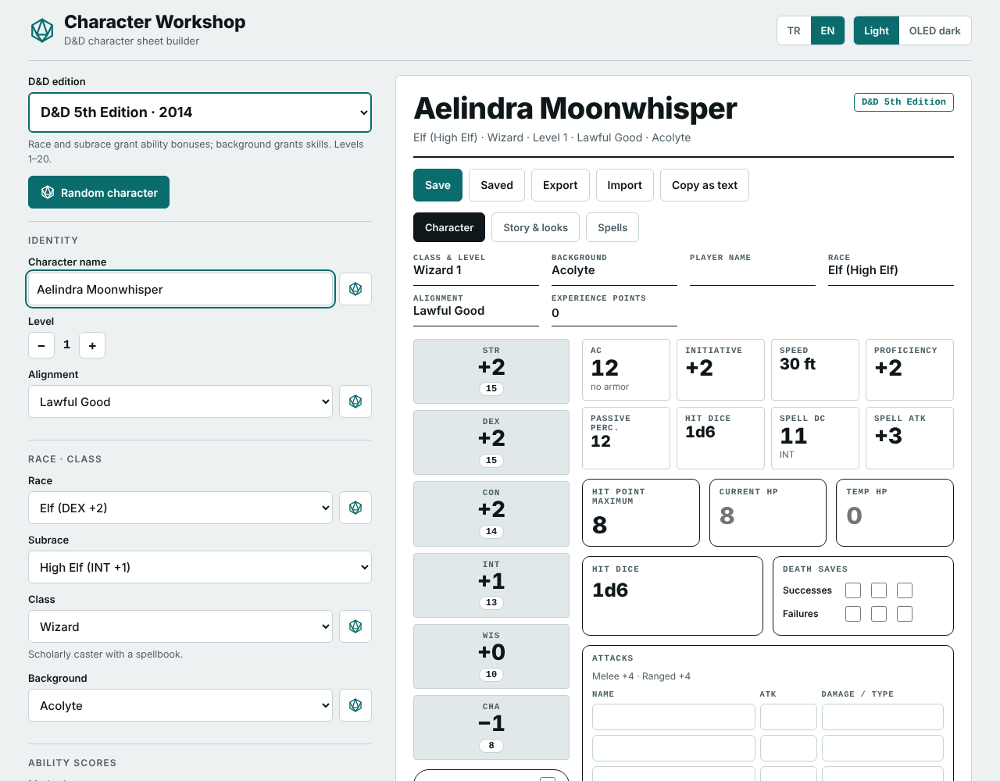
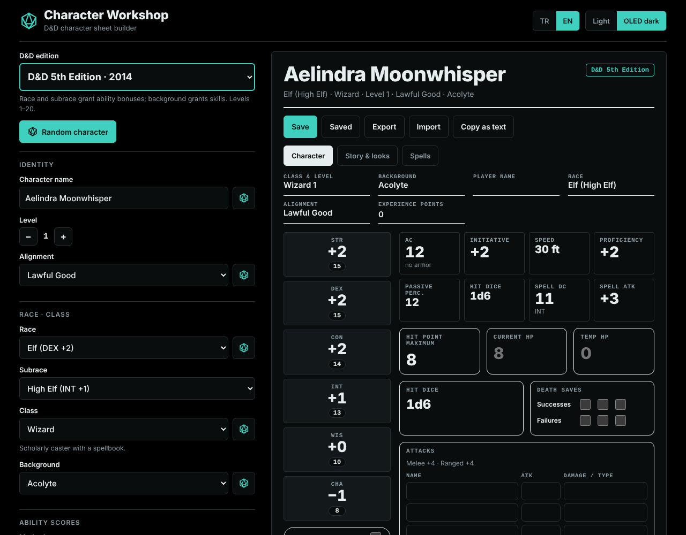
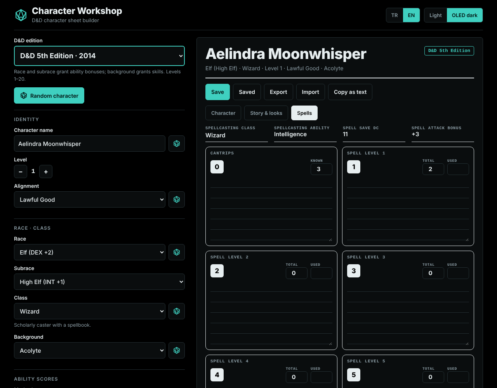
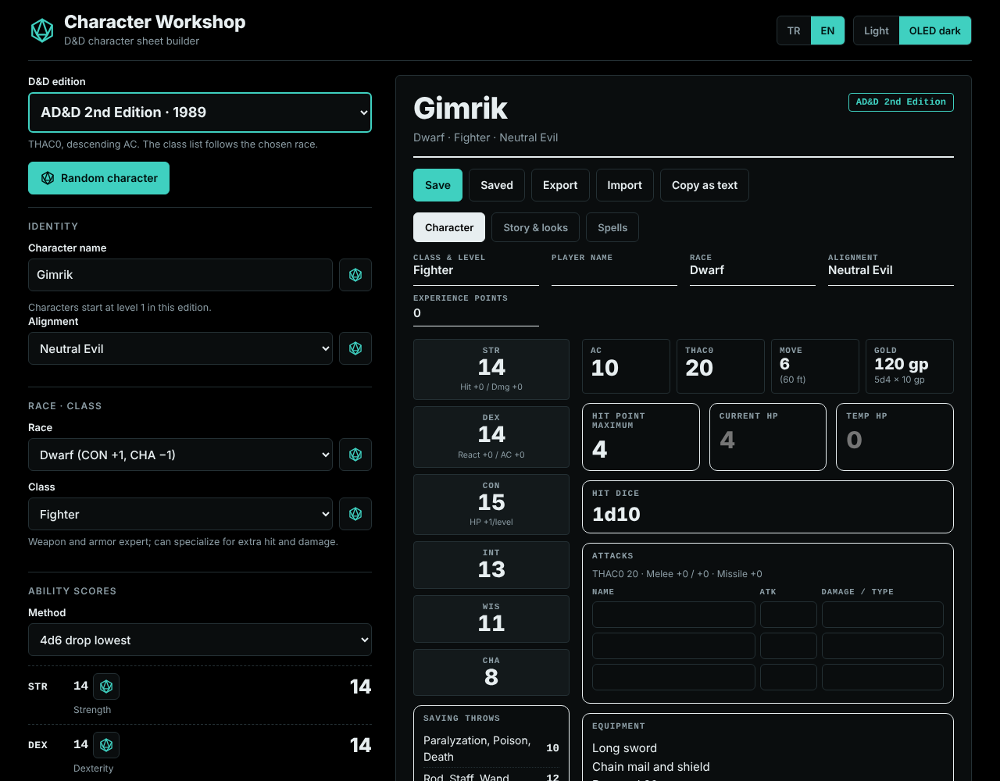

# 🎲 DND Character Workshop

A single HTML file that builds D&D character sheets for six editions of the game. Pick an edition and the creation screen, the rules and the three-page sheet all follow it. No server, no build step, no installation, no internet connection. Download one file, open it and create your character.

## 🚀 Key Features

* ✅ **Zero setup:** One HTML file, no dependencies, no web server. Works offline by double-clicking. The page makes no network requests at all, not even web fonts.
* ✅ **Six editions in one tool:** Choose from a dropdown and the form changes to match.
  * **B/X (1981):** Race-as-class, 3d6 in order, THAC0 19, saving throw tables, prime requisite XP bonus.
  * **AD&D 2nd Edition (1989):** Races with class restrictions, ability adjustment tables, THAC0, descending AC, weapon and nonweapon proficiency slots.
  * **D&D 3.5 (2003):** Point buy, BAB, saves, skill ranks (class and cross-class), feats, levels 1 to 20.
  * **D&D 4th Edition (2008):** Roles and power sources, four defenses, healing surges, trained skills, levels 1 to 20.
  * **D&D 5th Edition (2014):** Races and subraces, backgrounds, proficiencies, spell slots, levels 1 to 20.
  * **D&D 5.5 (2024):** Ability bonuses from the background (+2/+1 or +1/+1/+1) and an Origin feat for each background.
* ✅ **Random character:** One button rolls a whole character, or use the dice next to any field to randomize just that one.
* ✅ **Ability score methods:** 3d6, 4d6 drop lowest, standard array, point buy and manual entry, with an "auto-assign for class" helper.
* ✅ **Real character sheet:** Three pages inspired by the official 5E layout, adapted to the chosen edition.
  * **Character:** Ability scores, saves, skills, AC, initiative, speed, HP, hit dice, death saves, attacks, equipment, coins, personality, ideals, bonds and flaws.
  * **Story & looks:** Age, height, weight, eyes, skin, hair, **your own picture**, appearance, backstory, allies, additional features and treasure.
  * **Spells (Powers in 4e):** Slots per spell level, used slots and a lined spell list for each level.
* ✅ **Export and import:** Save the whole character, picture included, to a `.json` file and load it back later or on another device.
* ✅ **Saved characters:** Keep several characters in your browser and reload them with one click. Copy any sheet as plain text.
* ✅ **Private by design:** Nothing is uploaded. Everything you type is shown as plain text, never as HTML, and imported files are validated before use.
* ✅ **True black theme:** Pure `#000000` background for OLED screens, plus a light theme. The default follows your system.
* ✅ **Bilingual:** Turkish and English interface, selected automatically from your browser language and switchable at any time.
* ✅ **Phone ready:** The builder and the sheet switch between two tabs on small screens.

## 💻 Usage

> [!NOTE]
> There is nothing to install. The file runs entirely inside your browser.

1. Download `dnd-character-workshop.html`
2. Open it in any modern browser (double-click is enough)
3. Pick an edition, build your character, then **Save** or **Export** it

Limits: Class features beyond level 1 are not listed and 3.5 feat prerequisites are not checked. Spell slots are fully computed for 5e. In 3.5 they are computed only for Wizard, Cleric, Druid and Sorcerer; for other casters enter the slots by hand. B/X and AD&D 2e characters start at level 1.

> [!TIP]
> To use it on a phone, host the file on any static host (GitHub Pages, Netlify, Cloudflare Pages) and use "Add to Home Screen". Browsers store saved characters per site, so use **Export** and **Import** to move a character between devices.

## 📸 Screenshots

(Light theme, 5e Wizard)

(Pure Black theme, 5e Wizard)

(Spell page, pure black theme)

(AD&D 2nd Edition fighter)

## 🔒 Data & Privacy

No accounts, no tracking, no network requests. Saved characters live only in your browser's `localStorage`, together with your language and theme choice. An exported file is a plain JSON document that contains your character fields and your picture (as a JPEG, base64-encoded). Pictures are scaled down to 640 px on their longest side when you add them.

## 📋 Requirements

Any modern browser: Chrome, Edge, Firefox, Safari, or their mobile versions. There is nothing else to install.

## ⚖️ Disclaimer

This is an unofficial fan tool. Dungeons & Dragons is a trademark of Wizards of the Coast, and this project is not affiliated with them. Please do not add official character sheet PDFs or copyrighted rules text to this repository.

## 📄 License

Copyright (C) 2026 Oktay Mercan https://github.com/OKTAYMERCAN/DND-character-workshop

---
AI used.
